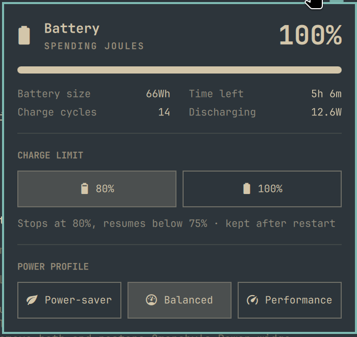

# battery

Cap how far your laptop battery charges, like macOS's "limit to 80%".
A small CLI plus an [Omarchy](https://omarchy.org) bar widget to switch it.

It writes the kernel's `charge_control_end_threshold`, so it works on Asahi
Linux MacBooks (`macsmc-battery`) and any other laptop whose driver exposes it
(ThinkPads, many ASUS/Dell/Framework models).



## Install

```bash
curl -fsSL https://raw.githubusercontent.com/logikaljay/battery/main/install.sh | bash
```

Pass options after `bash -s --`:

```bash
# also turn on an 80% limit that survives reboots
curl -fsSL https://raw.githubusercontent.com/logikaljay/battery/main/install.sh | bash -s -- --limit 80

# just the CLI, no Omarchy widget
curl -fsSL https://raw.githubusercontent.com/logikaljay/battery/main/install.sh | bash -s -- --cli-only
```

| Option | |
|---|---|
| `--limit <pct>` | Also set a charge limit and keep it at boot |
| `--cli-only` | Install just the CLI |
| `--no-restart` | Don't restart the Omarchy shell afterwards |
| `--uninstall` | Remove everything and restore Omarchy's Power widget |

`PREFIX` sets where the CLI goes (default `~/.local`) and `BATTERY_REF`
picks a branch or tag to install (default `main`).

From a clone, `./install.sh [options]` (or `make install`) installs the files
in the checkout instead of downloading them. Run it again after editing to
reinstall.

### What the installer does

1. Downloads the project from GitHub (or uses the checkout it runs from).
   The CLI is a bash script, so the same file works on x86_64 and ARM.
2. Copies `battery` to `~/.local/bin`.
3. If Omarchy is installed, copies `widget/` to
   `~/.config/omarchy/plugins/battery.power`.
4. If the Omarchy shell is running, swaps the widget in for Omarchy's
   **Power** widget in the bar, keeping that widget's settings (such as
   *show percentage*), disables any earlier clone of the Power widget (e.g.
   one made with `omarchy plugin clone omarchy.power`), and restarts the
   shell. Run from a TTY or over SSH with no shell running, it installs the
   widget and tells you to run `omarchy plugin enable battery.power` from the
   desktop.

Without Omarchy you get the CLI alone.

Requirements: Linux, bash, `curl` and `tar` (for the download), `jq` (for the
widget), and `sudo` or `pkexec` to change the limit.

## Uninstall

```bash
curl -fsSL https://raw.githubusercontent.com/logikaljay/battery/main/install.sh | bash -s -- --uninstall
```

or `./install.sh --uninstall` / `make uninstall` from a clone. This removes the
CLI and the widget and brings back Omarchy's own Power widget. The current
limit stays until you reboot; if you saved one for boot, the installer prints
the command that removes the boot rule.

## The bar widget

Click the battery icon in the bar. Between the battery stats and the power
profiles there is a **Charge limit** section:

- **80%**: stop charging at 80% and keep that after restarts.
- **100%**: charge fully and remove the boot rule.

The line under the buttons shows what the firmware is doing ("Stops at 80%,
resumes below 75% · kept after restart"). Each change asks for your password
once through the system's polkit prompt. The section hides itself if the CLI
is missing or the battery has no charge-limit support.

Everything else in the panel is Omarchy's own Power widget (at the version it
was copied from), so Omarchy updates to that widget do not reach this one.

## The CLI

```bash
battery                   # status: level, limit, whether it survives reboot
battery on                # stop charging at 80%
battery off               # charge to 100%
battery set 90            # custom limit (20–100)
battery persist [pct]     # apply a limit at every boot
battery unpersist         # stop applying it at boot
battery apply <pct>       # set now and keep at boot (100 lifts both)
battery status --shell    # tab-separated status for scripts
```

`BATTERY_DEVICE=<name>` picks a power supply when there is more than one.

Changing the limit needs root: in a terminal the CLI uses `sudo`; without one
(the bar widget, a keybinding) it re-runs itself once under `pkexec`.

### How the limit works

- The limit lasts until reboot. `battery persist` (or `apply`, or the widget)
  saves it as a udev rule in `/etc/udev/rules.d/99-battery-charge-limit.rules`,
  which applies it at every boot.
- **Apple Silicon:** the firmware has a single 80% mode. Setting the limit
  gives a stop at 80% and a resume point at 75%; other percentages may be
  rounded. The CLI reads the value back after every change and tells you
  what the firmware accepted.
- A battery that is already above the limit isn't drained: it runs down
  normally and then holds between the two thresholds while plugged in.

## Layout

```
battery        the CLI (bash)
widget/        Omarchy bar widget: a clone of omarchy.power with the
               charge-limit section (Panel.qml); the installer writes the
               CLI's path into it
install.sh     install / uninstall
Makefile       make install | install-cli | uninstall
```
